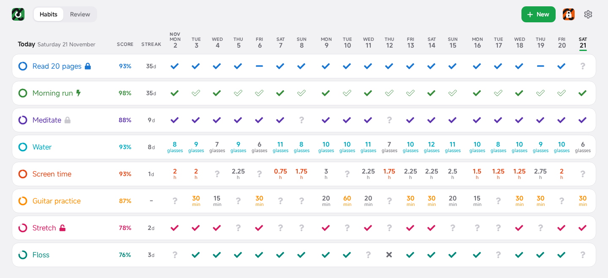
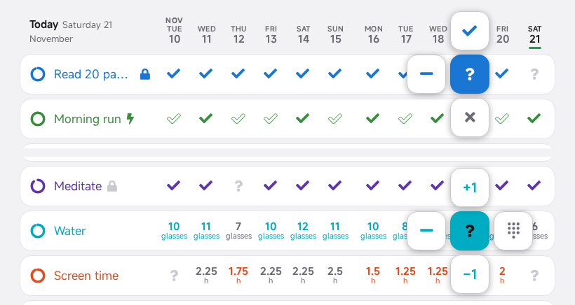
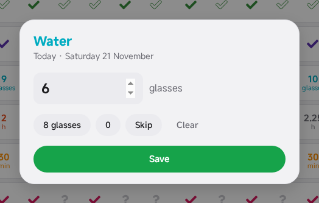
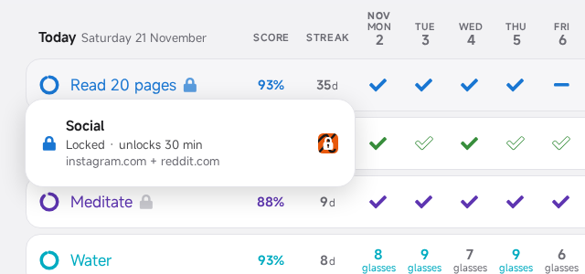
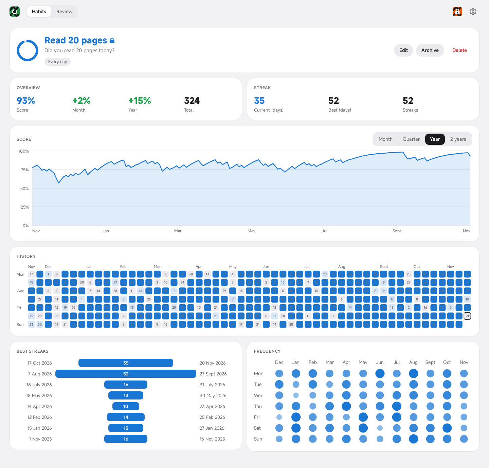
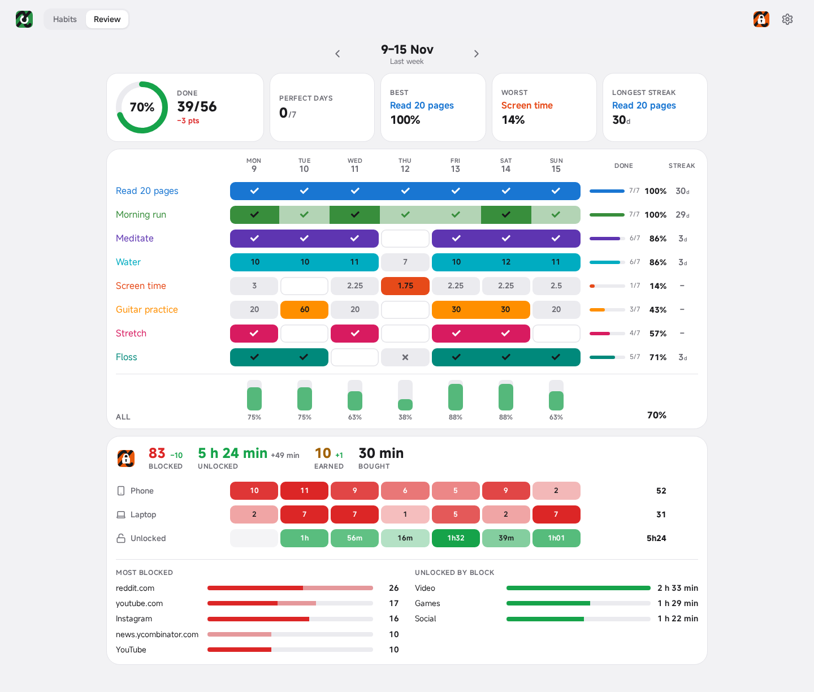
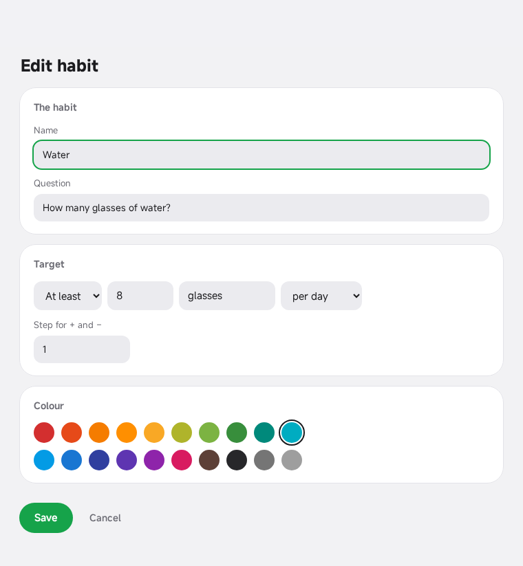
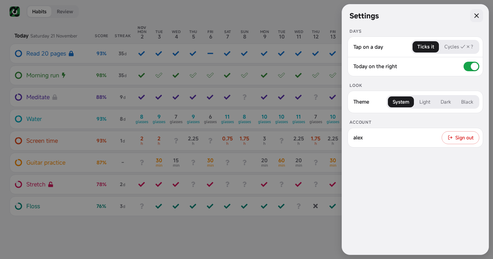
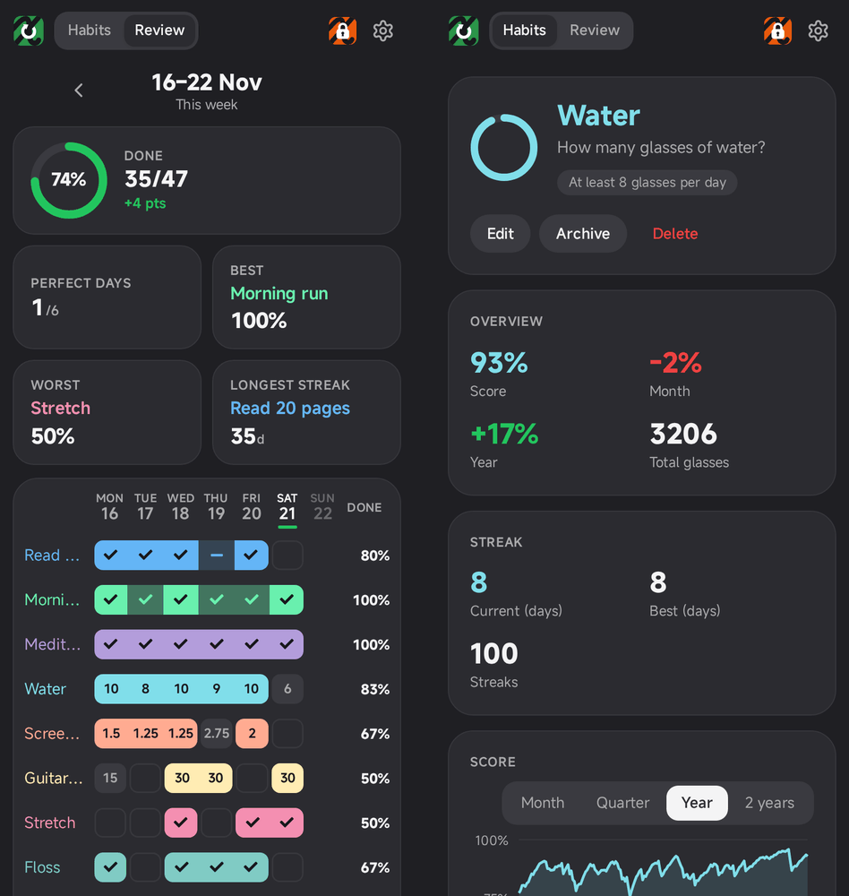

<p align="center"></p>
<h1 align="center">xrnloops</h1>

xrnloops is a fork of [Loop Habit Tracker](https://github.com/iSoron/uhabits), the open-source
Android habit tracker by Álinson S. Xavier (iSoron) and its contributors. It keeps Loop's habits,
scores, streaks, schedules, reminders and widgets, and adds three things Loop doesn't have: two-way
sync with a small server of your own, a web app for ticking and reviewing habits on a laptop, and a
link to xrnrule, an app blocker whose blocks unlock when habits are done. It installs next to the
store Loop as its own app (`com.xern.xrnloops`) and never talks to Loop's author or any third-party
service. The phone app is Kotlin on Android Views, as Loop is, for Android 9 and later; the server
is one Python file; the web app is plain JavaScript with no build step. Version 2.3.6.

Like Loop, it is free software under the GNU General Public License, version 3 or later. It is not
Loop, and Loop's authors neither make nor endorse it.

## Screenshots

These are the web app, served by the sync server from a throwaway data folder with made-up habits
and made-up xrnrule blocks, in headless Chromium. The phone app draws the same screens in the same
look (the web app follows its code piece by piece), but it is Android Views with no Compose
previews, so it can't be drawn without a device or an emulator.



The list: each habit's score ring, name and lock, its score and streak, and as many days as the
window holds, in weeks. Yes/no days show ✓ (entered), a light ✓ (covered by the habit's schedule),
✗ and – (skipped); number days show the amount and unit, in the habit's colour once the day's
share of the target is met.



Hold a day for a moment and slide. Yes/no: up ✓, down ✗, left – (skip), let go in the middle for
?. Number: up adds the habit's step, down takes one off, left skips, right opens the day's sheet.

| | |
|---|---|
|  |  |
| A number day's sheet: any amount, or a key for the day's target, 0, skip or clear. | The lock after a name: every xrnrule block that waits on the habit, and how it stands. |



A habit's page: overview, streaks, score over a month to two years, a year's calendar you can tick,
best streaks and how often by weekday.



The weekly review (web only): the share of habit-days done against the week before, perfect days,
best and worst habit, each habit's week as blocks, and, under xrnrule's tile, what its blocks did
that week on the phone and the laptop.

| | |
|---|---|
|  |  |
| The habit form, with the step for + and −. | Settings: what a tap does, today's side, theme, account. |



The same pages at phone width in the dark theme.

## What it adds to Loop

- **Sync with your own server.** Every habit and every day goes both ways between the phone, the
  web app and the server, in the background and as it happens (see [Sync](#sync)). Settings →
  "Sync with home server" takes the address, user and password and has Sync now. The password is
  kept in its own preferences file, outside Android's cloud backup.
- **A web app.** The server serves the phone's list and habit page for a browser: the same rows,
  glyphs, colours, locks and day gestures, with as many days as the window holds. Habits can be
  added, edited, archived and deleted there; reminders and the order of the list stay the phone's.
  It signs in once and then carries an HttpOnly cookie, and a write that can't go out waits in the
  browser and is retried every 10 s. It also has a **weekly review**, which the phone doesn't.
- **xrnrule's locks.** After a habit's name, a small lock in the habit's colour shows how the most
  useful xrnrule block that uses it stands: closed while the block waits on this habit, a bolt when
  an unlock is earned and only has to be opened, open while it is open, and grey once the habit has
  done its part and the block wants more. A tap lists every block that uses the habit ("Locked ·
  unlocks 30 min", "Ready to open · 45 min", "Open until 19:41", "Open · 12 min of use left"), and
  a tap on a block opens xrnrule there. When a tick here earns or opens a block, a banner says so
  ("Earned 30 min of Social") with an Open button. Nothing shows without xrnrule.
- **Tap and flick on a day.** "Tap on a day" either ticks it (tap again to clear) or cycles ✓ ✗ ?
  as Loop does. A short hold (170 ms) opens four keys around the day, like a Japanese phone
  keyboard (see the screenshot above). On the web a mouse that drags opens them at once, and a
  right-click leaves them open for the arrow keys and Enter.
- **+ and − by a step.** Number habits have a "Step for + and −" (default 1, from 0.001 to
  100000), which the flick's up and down keys add and take off. − never goes below 0, and the sums
  are kept in Loop's thousandths, so a step of 0.25 or 0.1 doesn't drift.
- **A day's sheet** in place of Loop's checkmark popup and number box: the habit's name and the day,
  then Done / Not done / Skip / Clear, or for a number the amount, with keys for the day's target
  (rounded towards meeting it), 0, skip and clear. A sheet writes only what was picked or typed, so
  it can't put back a value that sync changed while it was open.
- **The xrn look.** The xrn family's zinc greys and green, MiSans for all text (including what Loop
  draws on a canvas), rounded cards and rows with a hairline edge, and 7 days across a phone instead
  of 5. Its own launcher icon (the xrn family tile) and notification icon, the tile in the list's
  bar, and xrnrule's tile wherever the app sends you to xrnrule. Light, dark and pure black; habit
  colours stay Loop's.
- **A welcome screen** in place of Loop's intro slides: the link with xrnrule, signing in to the
  server or importing a Loop backup, and where the day ends. The list's menu reopens it ("Welcome &
  setup").
- **Sync trouble in the toolbar.** An amber cloud after two failed syncs in a row, or after one that
  needs you (a wrong password, or the server's lockout). A tap says what went wrong, with Retry or
  Settings. The web app shows the same cloud.

### What it takes out

- **Notes.** A day's note and a habit's own notes (Loop's Notes card and box) are gone from the
  phone and the web, by choice. They stay in the database, in sync, backups and exports, and every
  write carries the stored one forward, so nothing is lost.
- **Loop's links out.** Rate this app, Help & FAQ, Generate bug report, and the About rows that
  pointed at Loop's author, store listing, translation site and privacy policy. About names
  xrnloops, says it is based on Loop Habit Tracker, GPLv3, and keeps Loop's credits.
- **Other apps ticking habits.** Loop's widget receiver and its Tasker/Locale plugin are no longer
  exported, since a tick here can earn an unlock in xrnrule. Widgets and notifications still work
  through the app's own intents.

### Fixes to Loop's own code

Among them: "today" going stale when the app outlives midnight in the background; a weekly or
monthly number habit counting as completed only when one day held the whole target; reminders
crashing under the new app id; a crash when two threads used the database at once; an import that
could deadlock the app; a gap under a random row of the list; and the Android unit tests not
compiling. [XRNLOOPS.md](XRNLOOPS.md) has each change, why, and where it is.

## What stays Loop's

Habit score, flexible schedules (times per week or month, every N days), yes/no and measurable
habits with "at least" or "at most" targets, reminders with snooze, home-screen widgets, archive,
sorting and Hide completed, CSV and SQLite export, and import of Loop and other apps' backups. The
Kotlin packages stay `org.isoron.uhabits` so upstream changes still merge, and Loop's translations
are kept; the fork's own screens are in English only.

The database is at version 26 (the per-habit step, `migrations/26.sql`), so a backup made here no
longer imports into the store Loop, which reads up to 25. A store Loop backup still imports here.

## Sync

`server/xrnloops-sync.py` keeps each user's habits in one SQLite file. A record is a habit (by
uuid) or one habit's day, each stamped with the writer's clock (`mtime`); the last write wins per
record, and every accepted write takes the next sequence number. A client asks for everything after
the last number it saw (`GET /api/changes?since=N`, with `&wait=S` to long-poll) and sends its own
changes (`POST /api/changes`). xrnrule on the phone and the laptop reads the same feed to see which
habits are done.

- **The phone** finds its own changes by comparing the habit list with a snapshot of what the
  server last agreed to, so backup imports are caught too. Changes are stamped with when they were
  made, not when they got out, so a tick made offline still loses to a later change made elsewhere.
  It syncs 3 s after any change (with a one-off job 5 s later in case Android ends the process),
  when the app comes to the front, when xrnrule asks, about every half hour in the background, and
  right before a reminder shows, so a habit ticked on the laptop doesn't ring. While a screen is
  open, a long-poll brings in the web app's ticks as they happen. After a failure it backs off: 15 s
  doubling to 5 minutes, 15 minutes after a lockout, 30 minutes after a wrong password.
- **The web app** trades the password once for a 30-day HttpOnly cookie (`POST /api/session`;
  `DELETE` signs out) that counts only with an `X-Xrn-Client` header another site can't send.
  Signing out ends that cookie on every server that shares the users file.
- **A restored server** gets a new epoch, and every client starts over from the beginning; the phone
  sends everything again with the stamps it was agreed with, so newer phone edits and deletions
  survive the restore.
- **The day** follows the phone: its "Extend the day past midnight" setting travels with the feed,
  so the web app's and xrnrule's "today" start at the same hour.
- **Logins** are an htpasswd file of bcrypt hashes (Radicale's works as-is). Ten wrong passwords
  from one address in 15 minutes get 429 until they age out (an IPv6 address counts as its /64).

On the home server it runs as a runit service behind Tailscale Funnel at `/xrnloops`, and shares its
users file and session key with the other xrn sync servers, so one sign-in covers them. The full
design, including how a round survives a stop halfway, a restored server or a lost phone, is in
[XRNLOOPS.md](XRNLOOPS.md#sync-and-the-web-app).

## Working with xrnrule

xrnrule, a separate app, blocks apps and sites until habits are done. The two apps talk only
through Android IPC and the sync server, and xrnrule contains no Loop code:

- After every change xrnloops broadcasts `com.xern.xrnrule.action.HABITS_CHANGED`; xrnrule asks it
  to sync (`call("sync")` on `content://com.xern.xrnloops.provider`) and then reads the server.
- xrnrule answers `content://com.xern.xrnrule.links/links` with every block that uses a habit, and
  broadcasts `LINKS_CHANGED` when one changes; that is where the locks come from. The web app works
  the same rows out from xrnrule-sync's shared state on the same server (`/xrnrule/state`).
- Both apps declare the signature permission `com.xern.xrnrule.permission.HABITS`, so they must be
  signed with the **same key**, and no other app can ask for a sync, read the links or send either
  signal.

"Done" for xrnrule means a manual ✓ on a yes/no habit, or the day's share of an "at least" target
reached; Loop's auto-filled ✓, skips and "at most" habits never count. The contract, and the files
on both sides that mirror each other, are in [XRNLOOPS.md](XRNLOOPS.md#the-contract).

## Build and test

Gradle needs JDK 17 and Android SDK platform 36 (point `local.properties` at the SDK).

```sh
export JAVA_HOME=/usr/lib/jvm/java-17-openjdk
./gradlew :uhabits-core:jvmTest :uhabits-android:testDebugUnitTest :uhabits-android:ktlintCheck
./gradlew :uhabits-android:testDebugUnitTest --tests '*XrnTapTest'   # one class
python3 -m unittest server/test_xrnloops_sync.py                      # the sync server (needs bcrypt)
node --test web/test                                                  # the web app, under node
./gradlew :uhabits-android:assembleRelease                            # the APK, shrunk by R8
adb install -r uhabits-android/build/outputs/apk/release/uhabits-android-release.apk
```

Debug and release builds are signed with the key named in `../xrn-signing.properties` (beside the
repo: `storeFile`, `storePassword`, `keyAlias`, `keyPassword`) when that file exists. Without it,
debug builds use the machine's debug key and release builds come out unsigned. It has to be the key
xrnrule is signed with, or the second install fails with `INSTALL_FAILED_DUPLICATE_PERMISSION`.

The instrumented tests (view screenshots and UI tests) run on an API 35 emulator;
[docs/TEST.md](docs/TEST.md) has the steps. GitHub runs the JVM tests, ktlint, a compile of the
instrumented tests and the server's tests on every push (`.github/workflows/tests.yml`).

## Sync server

`server/xrnloops-sync.py` is one Python 3 file, standard library plus `bcrypt`. To try it and the
web app locally:

```sh
python3 -c 'import bcrypt; print("me:" + bcrypt.hashpw(b"pass", bcrypt.gensalt()).decode())' > /tmp/users
python3 server/xrnloops-sync.py --data /tmp/xrnloops-data --users /tmp/users --port 5234
# then open http://127.0.0.1:5234/ and sign in as me / pass
```

It serves `web/` at its root (`--web` to point elsewhere) and `GET /health` for monitoring. The
web app's locks and the review's xrnrule card come from xrnrule-sync at `../xrnrule/` on the same
host; without it the list has no locks and the card says it can't reach xrnrule.
`server/deploy.sh [ssh-host]` runs the server's and the web app's tests, copies the server and
`web/` together to a Termux + runit host, restarts the service and waits for `/health`; the data is
left alone.

## Moving your habits over from the store Loop

1. In the store Loop: Settings → Export full backup.
2. In xrnloops: Settings → Import data, and pick that file (or, if the habits are already on the
   server, sign in on the welcome screen).
3. In xrnrule, open a habit block's checklist and tap Link xrnloops habit.

The two apps don't interfere, so the store Loop can stay until everything has come across.

## Limits

- Not on Google Play or F-Droid: it is built from source and installed with adb.
- The web app needs the server to load; it keeps unsent writes, but not a copy of the habits for
  offline use. Reminders and the list's order are set on the phone, not in the browser.
- A backup made here doesn't import into the store Loop (database version 26).
- Notes are kept, but can't be seen or edited anywhere in the app or the web app.
- The fork's own screens aren't translated.
- This repo's copy of upstream's history has different commit hashes from
  [iSoron/uhabits](https://github.com/iSoron/uhabits) after August 2015 (same content: upstream's
  `7e993e17`, the fork's base, is `e542850b` here). Before merging a newer upstream, fetch it and
  run `git replace e542850b 7e993e17`, or git takes a commit of 2015 as the merge base.

## Layout

| Path | What |
|---|---|
| `uhabits-core/` | Loop's platform-independent models, scores, streaks, importers and database (Kotlin Multiplatform, JVM tests) |
| `uhabits-android/` | The Android app. The fork's own code is in `org/isoron/uhabits/xrn*/`: `xrnsync`, `xrnrule`, `xrntap`, `xrnnote`, `xrnlook`, `xrnwelcome` |
| `server/` | `xrnloops-sync.py`, its tests, and `deploy.sh` |
| `web/` | The web app: `app.js` (screens), `loop.js` (Loop's rules in JavaScript), `icons.js`, `style.css`, fonts, `test/` |
| `tools/make_web_icons.py` | Builds `web/icons.js` from Loop's Font Awesome glyphs |
| `docs/` | `TEST.md` (instrumented tests) and `screenshots/`; `BUILD.md` and `GUIDELINES.md` are upstream's |

## Credits and licence

xrnloops is based on [Loop Habit Tracker](https://github.com/iSoron/uhabits), copyright © 2016–2025
Álinson Santos Xavier and the Loop contributors, and is distributed under the same licence: the
GNU General Public License, version 3 or (at your option) any later version. See
[LICENSE.txt](LICENSE.txt). The changes made in this fork are listed with their dates in
[XRNLOOPS.md](XRNLOOPS.md). Loop's own changelog is [CHANGELOG.md](CHANGELOG.md), and its
translators are credited on the app's About screen.

Third-party code and fonts that come with Loop are listed in [NOTICE.md](NOTICE.md). The fork adds
MiSans Latin (`uhabits-android/src/main/res/font/xrn_misans_*.ttf`, `web/fonts/`): MiSans by Xiaomi,
used under the MiSans font licence (free for commercial use when the software notes that it uses
MiSans). The font files are not covered by this repository's licence.
https://hyperos.mi.com/font/en/

## Docs

- [XRNLOOPS.md](XRNLOOPS.md): every change from Loop, the xrnrule contract, and the sync design
- [docs/TEST.md](docs/TEST.md): running the instrumented tests on an emulator
- [server/xrnloops-sync.py](server/xrnloops-sync.py): the sync protocol, in the file's docstring
